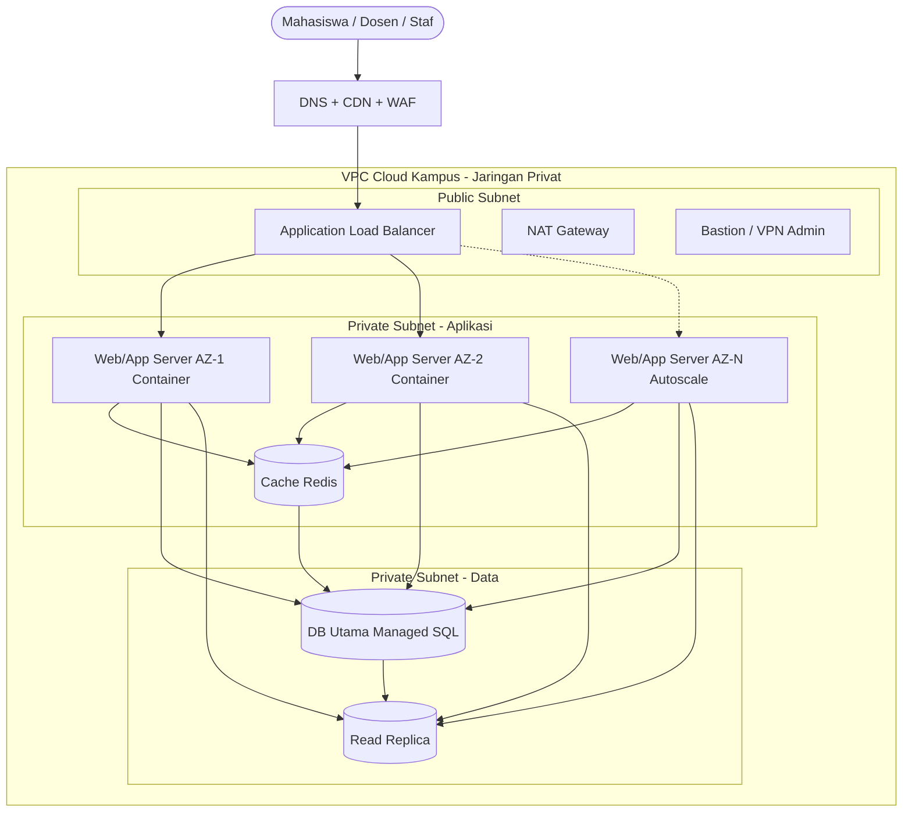
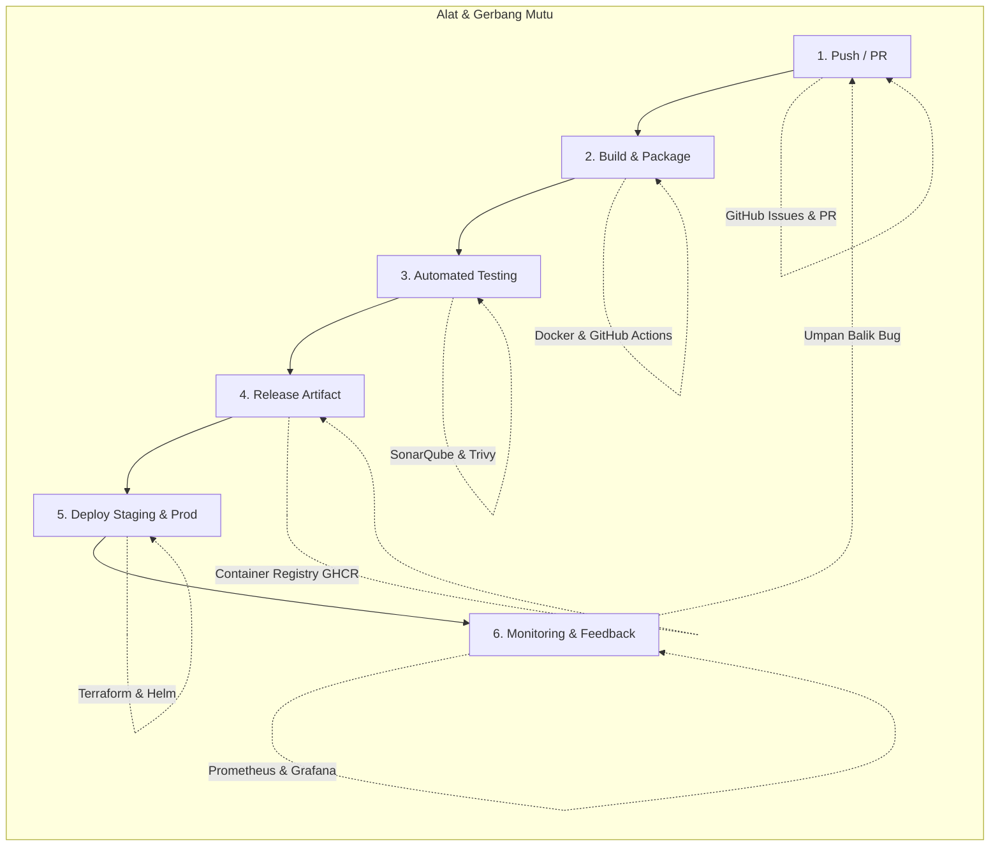
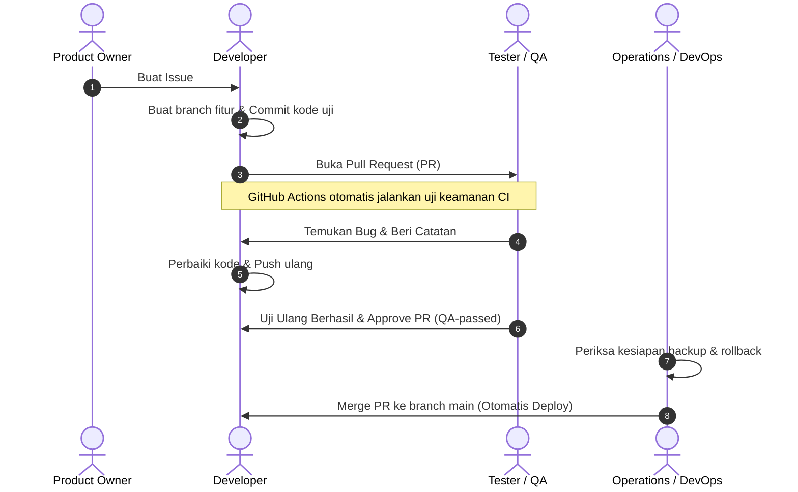

# 🏛️ Makalah UTS – Infrastruktur Cloud & Pipeline DevOps untuk Aplikasi Digital Kampus

Repositori ini memuat implementasi cetak biru (blueprint) untuk migrasi Sistem Akademik Digital Kampus (Pendaftaran, KRS, Nilai, UKT) ke Cloud Publik.

## 🌐 1. Diagram Arsitektur Cloud (Multi-AZ & Auto Scaling)

## 🚀 2. Diagram Pipeline CI/CD

## 🤝 3. Alur Kerja Kolaborasi Tim (GitHub Flow)

